

  

<h1 align="center">WinForge</h1>

<h3 align="center">Збери свою Windows — без сміття, телеметрії й реклами. Або наведи лад у тій, що вже стоїть.</h3>

  <a href="https://github.com/wooski515/WinForge/releases/latest/download/WinForge.exe">
    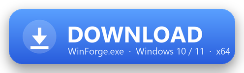
  </a>

  
  
  
  

  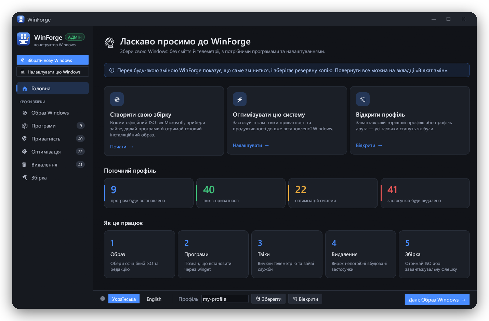

---

## ✨ Що вміє WinForge

  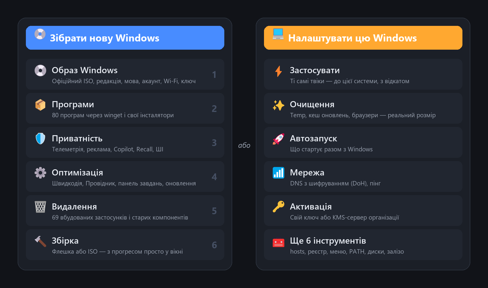

Угорі меню — **два режими**:

| | |
|---|---|
| 💿 **Зібрати нову Windows** | Береш офіційний ISO від Microsoft — отримуєш флешку або ISO, з якої ставиться вже налаштована система: без зайвих застосунків, з твоїми програмами й твіками. |
| 💻 **Налаштувати цю Windows** | Ті самі твіки, видалення й програми — для системи, яка вже стоїть. Плюс інструменти: очищення, автозапуск, DNS, hosts, активація та інше. |

---

## 💿 Зібрати нову Windows

### 1. Образ Windows
Обери офіційний ISO, редакцію, мову, розкладки й часовий пояс. Локальний обліковий запис без
акаунта Microsoft, пропуск екранів налаштування, обхід перевірки TPM для старих ПК.
За бажанням — **мережа Wi-Fi**, **свій ключ продукту**, **драйвери** зі своєї папки,
**стиснення системи** (CompactOS) і **доповнення для віртуалки**.

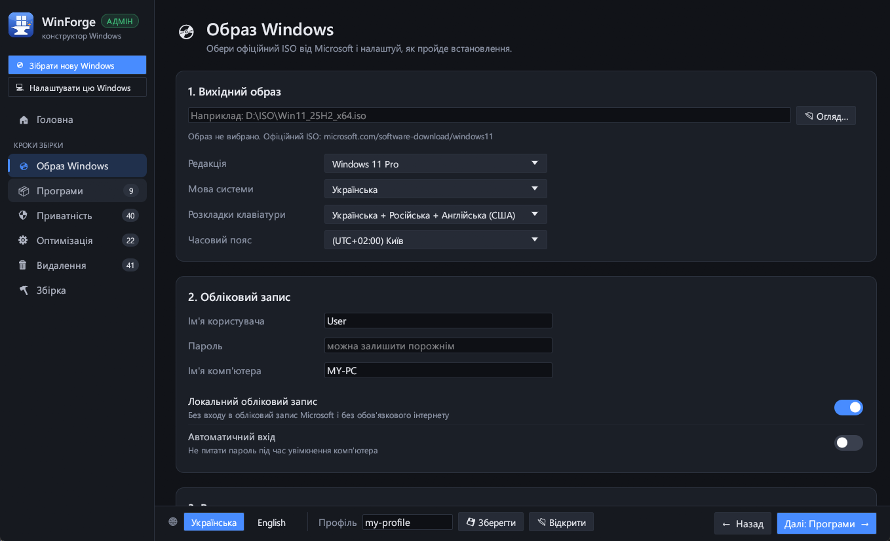

### 2. Програми
**80 програм** у каталозі (браузери, месенджери, ігри, розробка, мультимедіа) — став галочки,
і вони встановляться самі при першому вході через winget, завжди останніх версій.
Є готові набори «Базовий», «Геймер», «Розробник».

Свої програми теж можна: за ID з winget, своїм інсталятором або **цілою папкою інсталяторів** —
WinForge сам розпізнає тип (MSI, Inno Setup, NSIS, WiX…) і підставить ключі тихого встановлення.
Інсталятори їдуть на флешці й ставляться без інтернету.

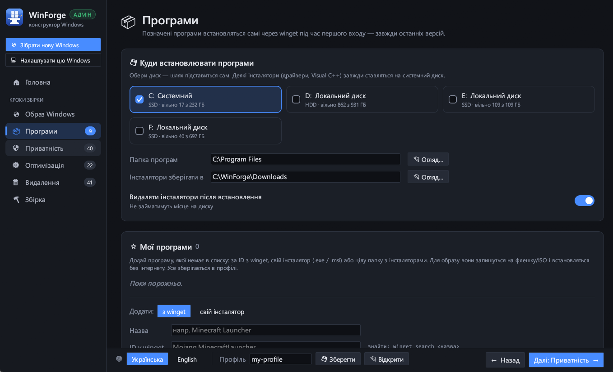

### 3. Видалення
**69 пунктів** у чотирьох розділах:

- 🗑 **Застосунки Microsoft** — Copilot, Bing, Outlook, Teams, Clipchamp, Xbox, Карти, Поради та ще десятки.
- 📢 **Реклама від партнерів** — Candy Crush, TikTok, Netflix, Spotify, пробні програми.
- 💻 **Утиліти виробників ноутбуків** — HP, Dell, Lenovo, ASUS, Acer, MSI, Samsung.
- 🧩 **Старі компоненти Windows** — режим Internet Explorer, WordPad, PowerShell 2.0 тощо.

Безпечні пункти позначено зеленим, а ті, що варто видаляти обережно, — жовтим і червоним із поясненням.

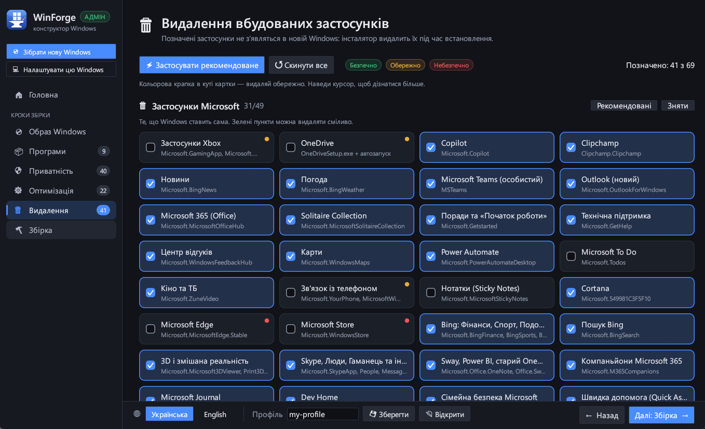

### 4. Збірка
Підсумковий план — і один клік. Флешка або ISO для віртуалки збирається **просто у вікні WinForge**:
кроки, відсотки, попередження, кнопка «Скасувати». Перед стиранням флешки WinForge ще раз перевіряє,
що це саме вона, і просить підтвердження.

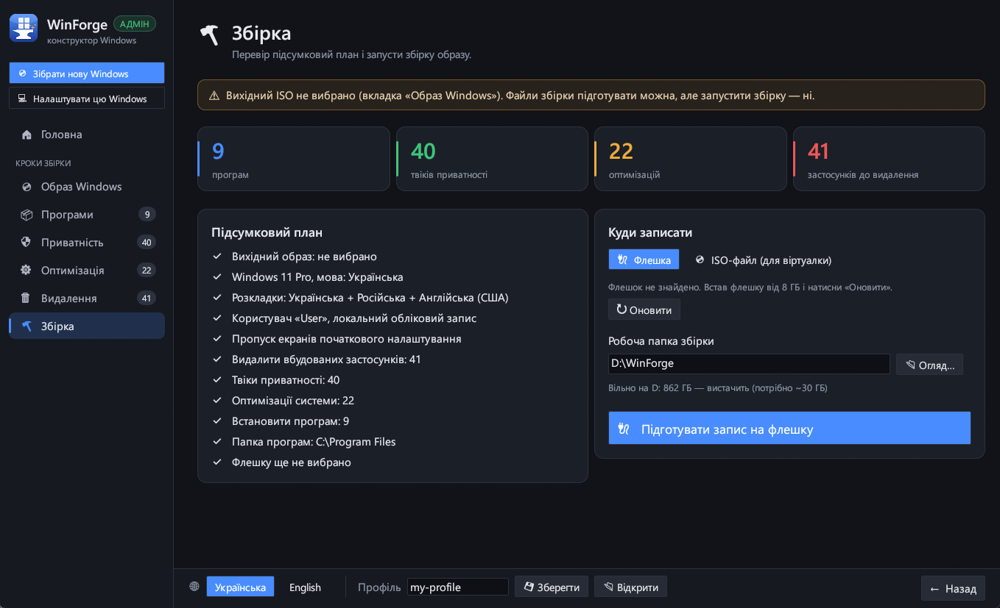

---

## 💻 Налаштувати цю Windows

### Приватність і оптимізація — понад 100 твіків
- 🛡 **Приватність:** телеметрія, рекламний ідентифікатор, історія дій, Copilot, Recall, Click to Do, ШІ в Paint, Блокноті й Edge.
- 📢 **Реклама:** у меню «Пуск», на екрані блокування, в Edge, у «Параметрах», автовстановлення ігор.
- ⚙ **Швидкодія:** план живлення, ігровий режим, Game Bar, анімації, фонові застосунки.
- 🗂 **Інтерфейс:** класичне контекстне меню, «Завершити завдання» на панелі завдань, Провідник без «Головної» й «Галереї».
- 🔄 **Оновлення:** без перезавантажень, без роздачі іншим ПК, відкладення великих оновлень.
- 🧩 **Компоненти:** .NET 3.5, WSL, Пісочниця, Hyper-V.

Наведи курсор на будь-який пункт — WinForge покаже, що саме зміниться в системі.

<table>
  <tr>
    <td>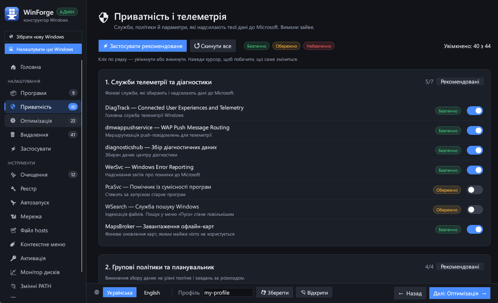</td>
    <td>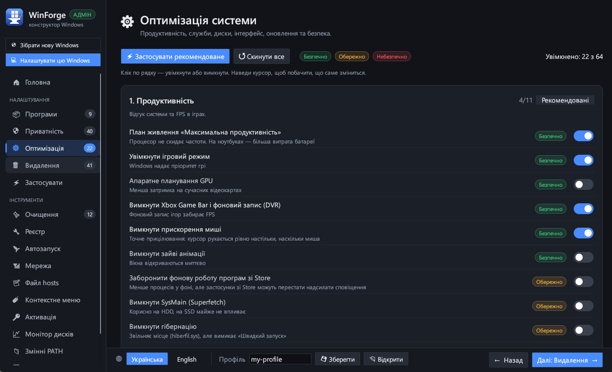</td>
  </tr>
  <tr>
    <td align="center"><b>Приватність</b></td>
    <td align="center"><b>Оптимізація</b></td>
  </tr>
</table>

### Застосувати — безпечно
1. Спершу WinForge **лише перевіряє** систему й показує, що вже зроблено, а що зміниться.
2. Перед змінами створює **точку відновлення** Windows.
3. Кожна зміна пишеться в журнал — її можна **відкотити** на вкладці «Відкат змін».

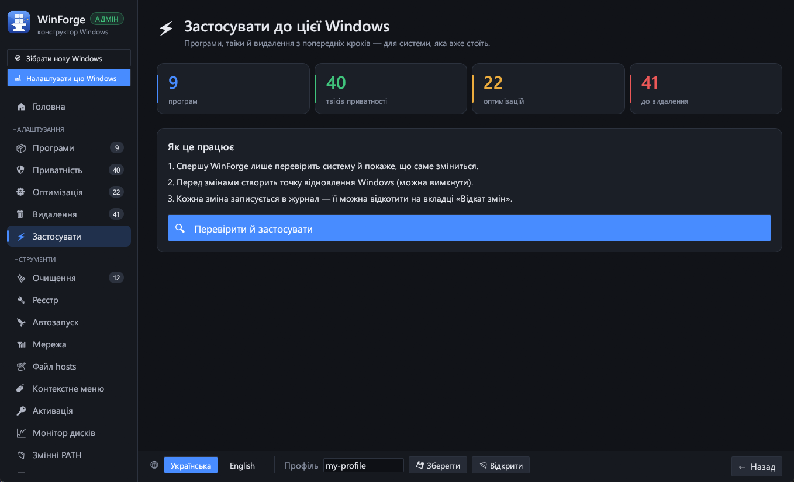

### Інструменти

| | |
|---|---|
| ✨ **Очищення** | Тимчасові файли, кеш оновлень, дампи, кеш браузерів — спершу аналіз із реальним розміром |
| 🔧 **Реєстр** | Розблокування Диспетчера завдань, regedit, «Виконати» та виправлення Windows |
| 🚀 **Автозапуск** | Усе, що стартує разом із Windows, — вимкнути можна в один клік |
| 📶 **Мережа** | Готові DNS (Cloudflare, Quad9, AdGuard…) **із шифруванням DNS-over-HTTPS**, пінг |
| 📝 **Файл hosts** | Редактор і готові набори блокувань |
| 🖱 **Контекстне меню** | Корисні пункти правого кліку й свої команди Win+R |
| 🔑 **Активація** | Стан ліцензії, **свій ключ продукту** або KMS-сервер твоєї організації |
| 📈 **Монітор дисків** | Заповненість, живий графік, найактивніші процеси |
| 📁 **Змінні PATH** | Мертві шляхи, дублікати, порядок |
| 🖥 **Обладнання** | Процесор, пам'ять, відеокарта, диски, мережа |

<table>
  <tr>
    <td>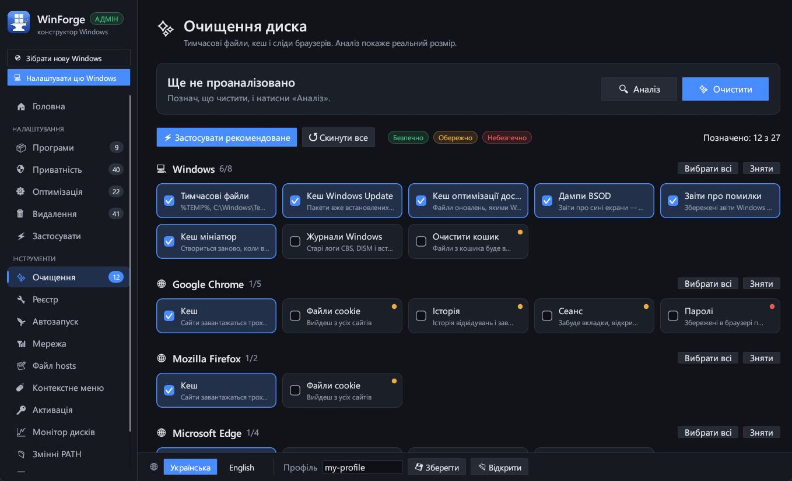</td>
    <td>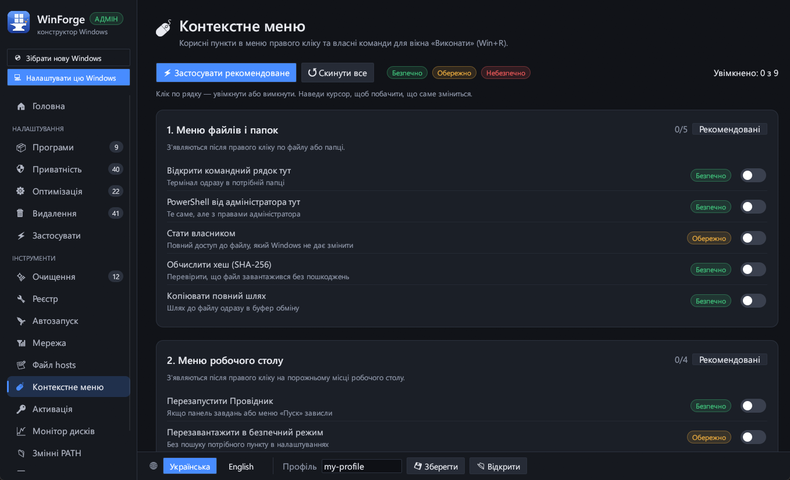</td>
  </tr>
  <tr>
    <td align="center"><b>Очищення диска</b></td>
    <td align="center"><b>Контекстне меню</b></td>
  </tr>
</table>

---

## 🚀 Як запустити

**Найпростіше:** натисни **DOWNLOAD** угорі й запусти `WinForge.exe`. Встановлювати нічого не треба —
це один файл, працює навіть на щойно встановленій Windows без драйверів відеокарти.

> Якщо Windows покаже «Windows захистив ваш ПК» — це тому, що програма нова й без цифрового
> підпису. Натисни **«Докладніше» → «Виконати однаково»**.

**З вихідного коду:** двічі клацни **`!Start WinForge.cmd`** у корені папки. Він запустить готовий exe,
а якщо його ще немає — збере (потрібен [Rust](https://rustup.rs)).

Для змін у системі запусти WinForge **від імені адміністратора** — без цього він працює в режимі перегляду
й сам запропонує перезапуститися.

### Що потрібно для збірки своєї Windows
- офіційний ISO Windows 10 або 11 ([завантажити в Microsoft](https://www.microsoft.com/software-download/windows11));
- ~30 ГБ вільного місця на будь-якому диску;
- флешка від 8 ГБ (або ISO-файл — для віртуалки).

---

## 🔒 Безпека

- **Нічого без попереднього перегляду.** Будь-яке застосування спершу показує, що зміниться.
- **Точка відновлення й журнал відкату** для кожного застосування.
- **Захист Windows не вимикається автоматично:** Defender, UAC, SmartScreen, BitLocker лишаються як були.
- **Секрети не зберігаються.** Пароль акаунта, пароль Wi-Fi і ключ продукту не пишуться в профіль,
  а в новій системі стираються одразу після використання.
- **Відкритий код** — усі твіки описані в TOML-файлах у папці [`catalog/`](catalog), їх можна прочитати й змінити без перекомпіляції.

---

## ❓ Питання

<b>Чи можна повернути все як було?</b>

Так: твіки відкочуються на вкладці «Відкат змін» або через точку відновлення Windows.
Видалені вбудовані застосунки повертаються з Microsoft Store.

<b>Python, Git, Node.js самі додаються в PATH?</b>

Так — WinForge ставить їх через winget з параметрами, які додають PATH (Python — з `PrependPath=1`).
Нові шляхи видно у вікнах терміналу, відкритих після встановлення.

<b>Чи збереться все знову через рік?</b>

Так: кнопка «Зберегти» внизу зберігає всі галочки й налаштування в профіль `.toml`.
Відкрий його через рік або на ПК друга — і збери ту саму Windows ще раз.

<b>Яка мова інтерфейсу?</b>

Українська та англійська — перемикач унизу вікна.

---

  Для розробників — <a href="docs/DEVELOPMENT.md">як усе влаштовано всередині</a>

